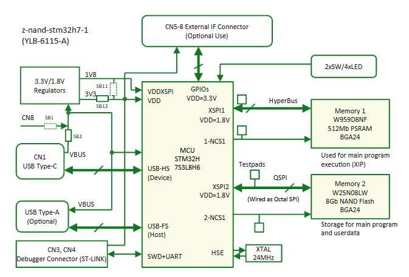
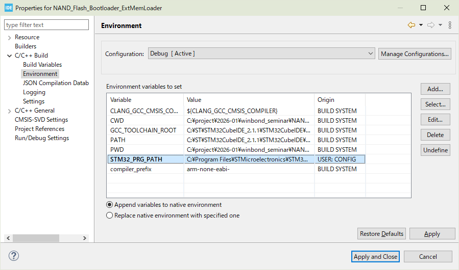
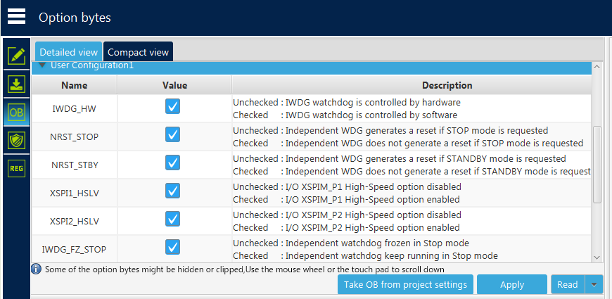
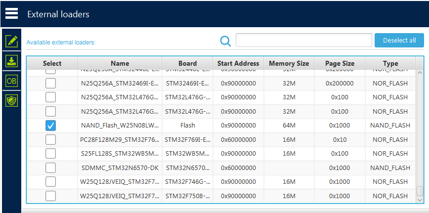
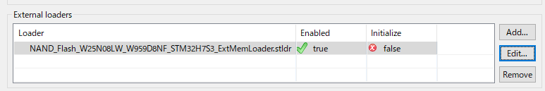
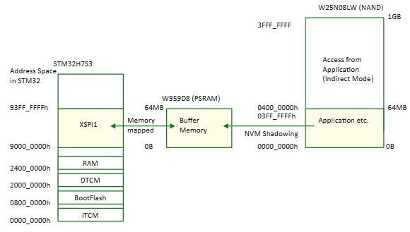
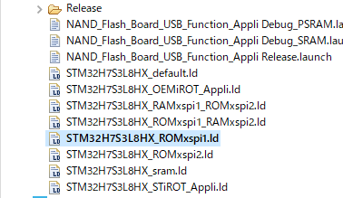

# ExtMemLoader Project for W25N08LW+W959D8NF+STM32H7S3 Serial Memory Board [YLB-6115-A]

(c) 2026 H.Yamada (Y-Logic)

## 概要

このプロジェクトは、シリアル NAND Flash 搭載基板 [YLB-6115-A / z-nand-stm32h7-1] の外部メモリへの書き込みを行う ExtMemLoader プロジェクトです。

上図に本基板のブロック図を示します。本基板は STM32 マイコン STM32H7S3L8H6 と Quad SPI の 1GB NAND Flash ROM、HYPERBUS による 64MB PSRAM を実装しています。STM32H7S3 は BootFlash シリーズの STM32 マイコンであり、MCU 上にブートローダ格納向けの小容量 (64kB)  Flash ROM しか搭載していません。このため、アプリケーションコードのバイナリやそのほかのデータは外部 NAND Flash に格納することになります。

NAND Flash への書き込みや Verify は既製のブートローダでは対応していないため、ユーザ側で実装する必要があります。このプロジェクトでは、STM32Cube の ExtMemLoader と呼ばれる仕組みにより、STM32CubeProgrammer や STM32CubeIDE から NAND Flash への書き込み方法を提供します。

## 外部メモリとの接続

STM32H7S3L8H6 は 2 つの XSPI モジュールを持ちます。XSPI と外部メモリの接続は下記の通りです。

XSPI1 -> HYPERBUS (1.8V) -> PSRAM (W959D8NFYA5I)

XSPI2 -> Quad SPI (1.8V) -> NAND Flash (W25N08LWTBIG)

XSPIの機能により、 XSPI1 に接続された PSRAM はメモリマップモードで使用することが可能です。XSPI は NAND Flash のメモリマップに対応ていないので、XSPI2 に接続された NAND Flash は、コマンドモード（インダイレクトモード）でのみ動作します。

## ExtMemLoader の使い方

ExtMemLoader は STM32 のメモリ上で動作するバイナリであり、STM32CubeProgrammer や STM32CubeIDE から ST-Link などのデバッガツールを通して STM32 にロードされます。本プロジェクトをビルドすると、それらのツールに対して ExtMemLoader がインストールされます。

ビルドの際は、プロジェクトの設定が必要です。プロジェクト設定より、`STM32_PRG_PATH` に STM32Programmer のインストールパスを設定してください。

STM32CubeProgrammer のパスを適当に設定したうえでビルドすると、ビルド後スクリプトによりSTM32CubeProgrammer に ExtMemLoader がインストールされます。**Windows の場合は、ビルド時に CubeIDE を管理者として実行する**必要があります。

手動でインストールする場合は、ビルドされた`.elf`ファイルの拡張子を `.stldr` に変更して、STM32CubeProgrammer の ExtLoader パス

 `C:\Program Files\STMicroelectronics\STM32Cube\STM32CubeProgrammer\bin\ExternalLoader` 

と STM32CubeIDE の ExtLoader パス

`(STM32CubeIDE)\plugins\com.st.stm32cube.ide.mcu.externaltools.cubeprogrammer.win32_2.2.400.202601091506\tools\bin\ExternalLoader`

にコピーしてください。

### 事前準備

あらかじめ STM32CubeProgrammer からマイコンの OPTION Bytes のうち XSPI1_HSLV, XSPI2_HSLV を有効にしてください。**これらが無効になっていると、書き込みやベリファイに失敗します。**

### STM32CubeProgrammer で使う場合

External Loaders 画面から、`NAND_Flash_W25N08LW_W959D8NF_STM32H7S3_ExtMemLoader.stldr` の Select にチェックを入れて有効にします。

### STM32CubeIDE で使う場合

Run Configurations から、 External loaders に `NAND_Flash_W25N08LW_W959D8NF_STM32H7S3_ExtMemLoader.stldr`を指定します。通常の Run/Debug で、0x9000_0000 の書き込みに対して、この ExtMemLoader が使われます。

## メモリ空間

PSRAM 領域 (XSPI1 = Address **0x9000_0000-**) を ExtMemLoader の管理対象とします。

STM32 のメモリ空間のうち、0x9000_0000 から 0x9400_0000 までの 64MB は XSPI1 に割り当てられています。このメモリ空間が ExtMemLoader の書き込み先のアドレス空間となります。

この ExtMemLoader が前提とするブートローダは、XSPI1 をつかって外部 PSRAM をメモリマップして、NAND Flash の内容を PSRAM にコピーします。そして、PSRAM 上のアプリケーションプログラムを実行します。

この ExtMemLoader は 0x9000_0000- のメモリ空間への書き込みを行うと、データを XSPI2 (NAND Flash) に同時に書き込むようになっています。基本的に ExtMemLoader の読み込みはメモリ空間からの読み込みとなりますが、実は`Read` 関数をエクスポートすることで API による間接読み込みも可能です。

なお、内蔵 Flash ROM (BootFlash) などの 0x9000_0000- 以外へのアクセスは、ExtMemLoader ではなく通常の SWD ローダが動作します。

## NAND Flash に格納するプログラムの作り方 (STM32CubeIDE)

STM32H7S3 で NAND Flash にプログラムを格納して実行するには、Bootloader プロジェクトと Application プロジェクトの対応が必要です。

Bootloader は、外部メモリから RAM にプログラムを転送して、プログラムカウンタをそこにジャンプする動作が必要です。今回の場合、PSRAM のメモリマップ初期化と、NAND Flash から PSRAM にプログラムを転送して、そこにジャンプします。Bootloader の作り方はここでは省略します。

Application は、STM32CubeMX で生成したプロジェクトの場合、Application プロジェクトにはいくつかのリンカスクリプトが生成されると思います。プロジェクト構成から`STM32H7C3L8HX_ROMxspi1.ld`を使用します。通常通りビルドすれば、プログラムの配置先が XSPI1 (0x9000_0000-) になったバイナリ (.elf) が生成されます。 

あとは、STM32CubeProgrammer か STM32CubeIDE を使って外部 NAND Flash に書き込みます。

このほか MPU を使用する場合、この領域に命令実行権限を与えることに注意してください。
